<div align="center">

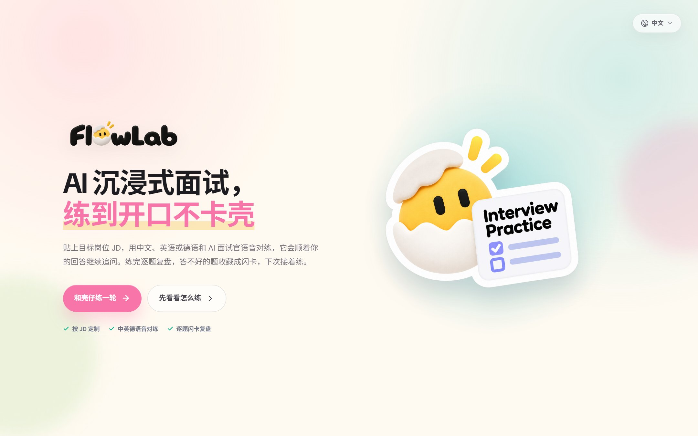

<br/>

# FlowLab · 不卡壳实验室

### AI 沉浸式面试，练到开口不卡壳 🥚

贴上目标岗位 JD，用 **中文、英语或德语** 和 AI 面试官语音对练——<br/>
它会顺着你的回答继续追问。练完逐题复盘，答不好的题收藏成闪卡，下次接着练。

<br/>

[](https://global.flowlab-career.com) &nbsp; [](#-功能一览) &nbsp; [](#-背后的技术) &nbsp; [](#-能量值)

[认识壳仔小队](#-认识壳仔小队) · [三步练到能上场](#-三步从一份-jd-练到能上场) · [功能一览](#-功能一览) · [背后的技术](#-背后的技术) · [开发者入口](#-开发者入口)

</div>

<br/>

## 🥚 为什么叫「不卡壳」

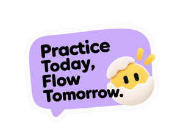

刷了一百道题，面试官却一直问 Behavioral；对着镜子练口语，没人追问，永远不知道漏洞在哪；
简历改了十版，投出去还是没有回音……

**FlowLab 是为赴德实习、Werkstudent、校招和升学面试准备的 AI 求职陪练。**
它不是又一个聊天机器人，而是一套 **读懂你的简历、读懂你的 JD、按真实面试节奏追问** 的完整训练流程：

> 岗位与 JD → 定向简历 → 模拟面试 → 逐题复盘 → 闪卡再练

从校园到职场，开口不再卡壳。

<br clear="right"/>

<br/>

## 🐣 认识壳仔小队

**不同的卡壳时刻，交给不同的壳仔。** 我们把复杂的 AI 能力变成四个有性格的伙伴——你不用研究工具，只要选择此刻最需要的帮助。

<table>
<tr>
<td align="center" width="25%"></td>
<td align="center" width="25%"></td>
<td align="center" width="25%"></td>
<td align="center" width="25%"></td>
</tr>
<tr>
<td align="center"><b>🔍 岗位侦探</b><br/><sub>读懂 JD，识别岗位与关键词，找出这一轮最值得问什么</sub></td>
<td align="center"><b>✂️ 简历裁缝</b><br/><sub>把你已有的经历改写成岗位想看到的样子——只改措辞，不编经历</sub></td>
<td align="center"><b>🎙️ 面试教练</b><br/><sub>真实语音、连续追问、中英德三语，把答案练成自然表达</sub></td>
<td align="center"><b>🌱 复盘学长</b><br/><sub>对照回答、参考思路和改进动作，下一轮就能立刻用上</sub></td>
</tr>
</table>

<br/>

## 🪜 三步，从一份 JD 练到能上场

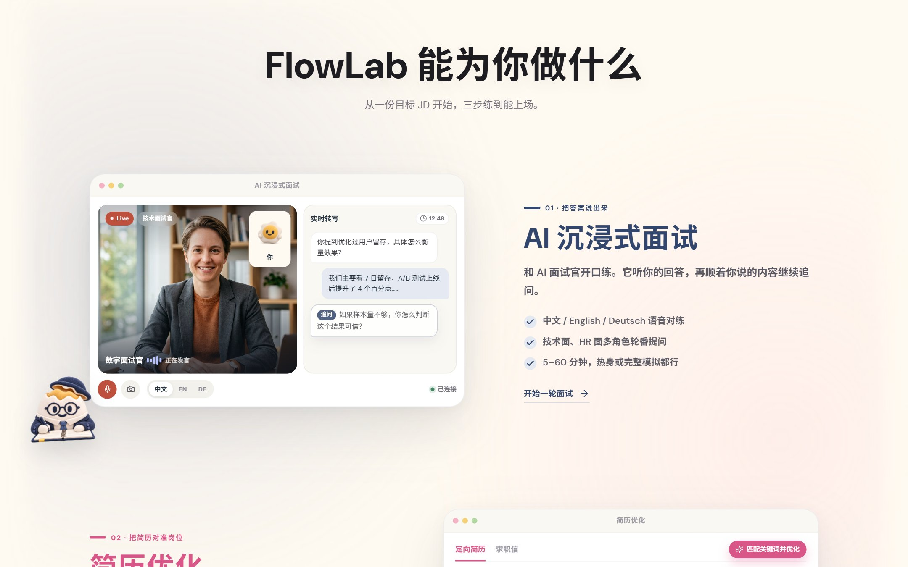

| | 你要做的 | 壳仔会做的 |
|:---:|---|---|
| **01** | 粘贴目标岗位 JD，带上你的简历 | 自动识别岗位和类型，读懂你的经历，决定这一轮真正值得问什么 |
| **02** | 和 AI 面试官聊一轮，用说的 | 顺着你的回答连续追问；技术面、HR 面多角色轮番上场 |
| **03** | 打开报告，用闪卡逐题复盘 | 五维评分、逐题差距与参考思路，答不好的题收藏成闪卡下次再练 |

<br/>

## ✨ 功能一览

### 🎙️ AI 沉浸式面试

<table>
<tr>
<td width="50%">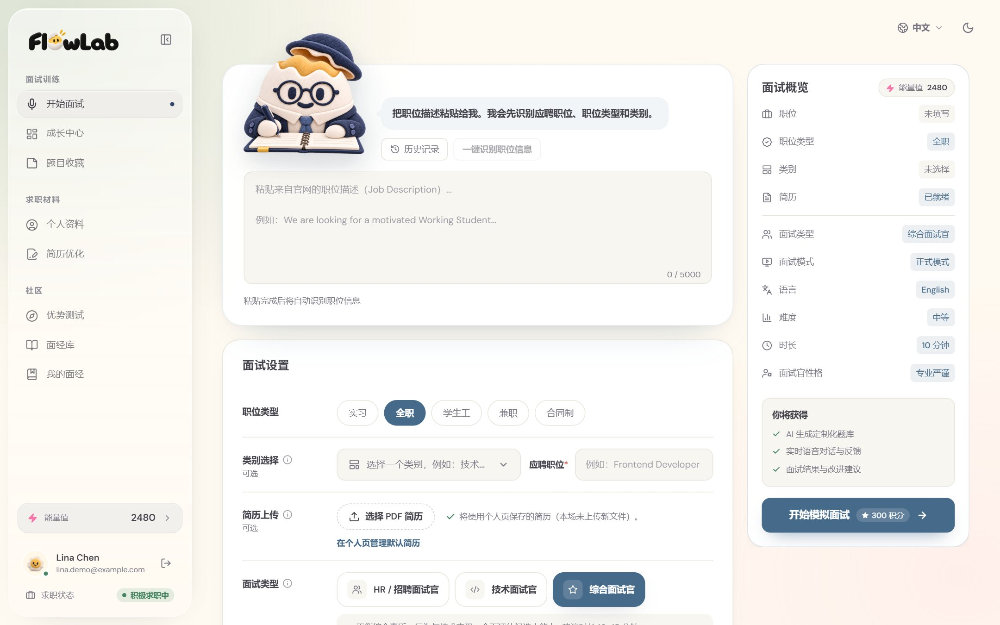</td>
<td width="50%">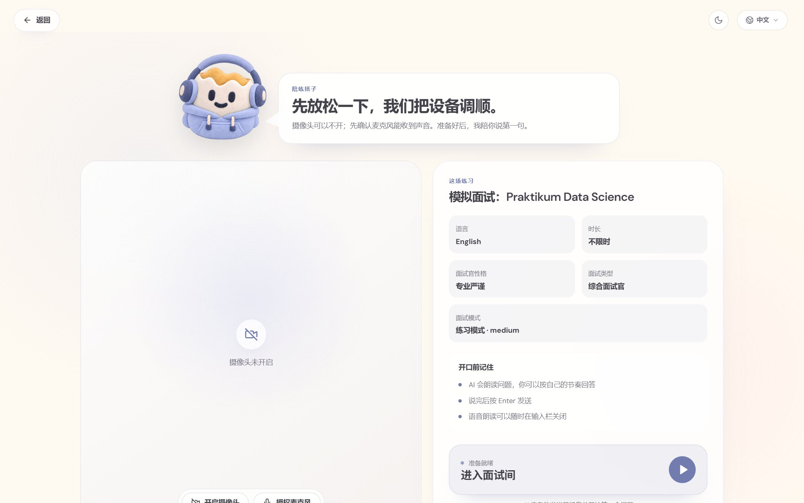</td>
</tr>
</table>

- **按 JD 定制**：先贴 JD，再选面试官类型（HR / 技术 / 综合）、性格（专业严谨、温和鼓励、严厉压力、深度分析）、难度和语言。
- **两种模式**：**练习模式** 可以随时暂停、看提示、重答、跳过；**正式模式** 连续计时，结束后统一出报告——像真的一样。
- **真实语音对练**：Zoom 式面试房间，开摄像头、开麦克风，和面试官直接开口聊；5–60 分钟，热身或完整模拟都行。
- **断线不慌**：刷新页面或网络断开，回到这场面试就能从原来的进度继续。

### 📊 面试复盘 & 成长中心

<table>
<tr>
<td width="50%">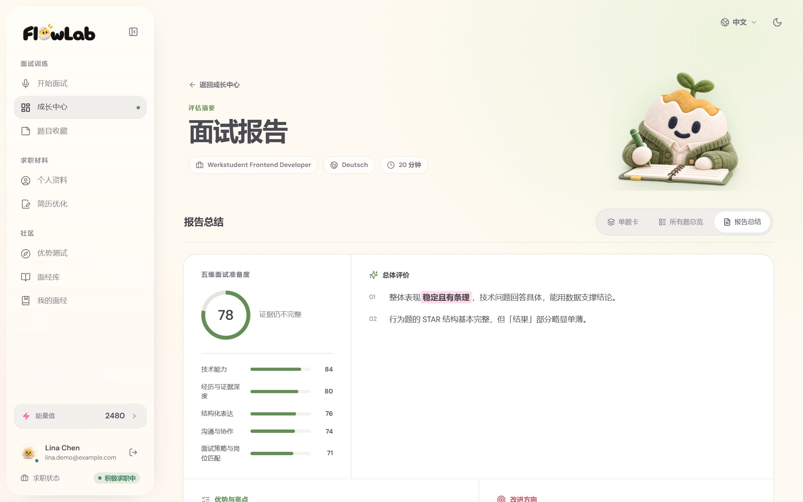</td>
<td width="50%">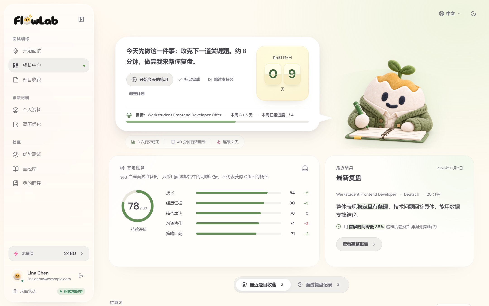</td>
</tr>
</table>

- **五维面试准备度**：技术能力、经历与证据深度、结构化表达、沟通与协作、面试策略与岗位匹配——每个判断都来自你这一场的真实回答。
- **逐题对比**：你的回答、主要差距、改进建议和参考思路一题一卡，报告还会自动翻译成你的界面语言。
- **Offer 冲刺计划**：设定目标岗位和面试日期，壳仔每周排出 3–5 件最重要的小任务，打开就知道「今天先做这一件」。

### 🃏 闪卡复盘


答不好的题一键收藏，在 **题目收藏** 里变成闪卡：先自己回想，再翻面看回答要点和反馈，写下私人笔记，觉得会了就标记掌握，没把握就 **再练一次**。

<br clear="right"/>

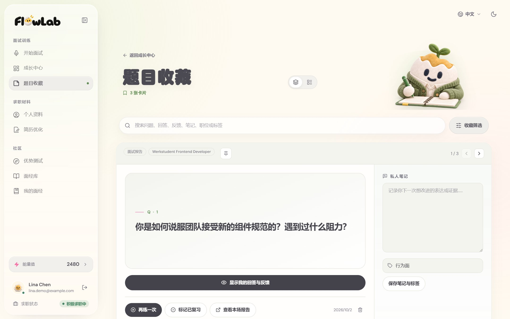

### ✂️ 简历优化 & 个人资料

<table>
<tr>
<td width="50%">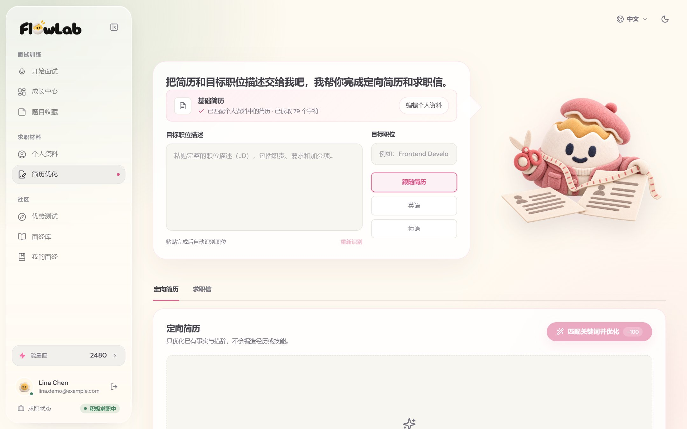</td>
<td width="50%">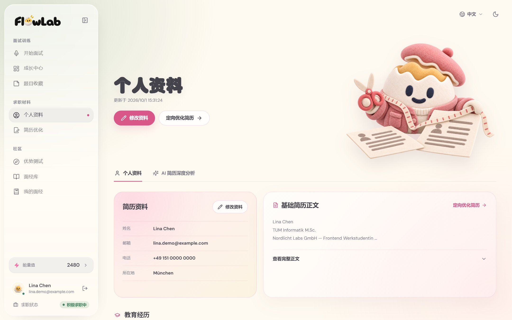</td>
</tr>
</table>

- **定向简历**：贴上 JD，自动识别关键词，把简历对准岗位；没有证据支撑的关键词 **不会被强行写进简历**。
- **求职信**：同步生成，可导出 Word / PDF。
- **简历诊断**：上传 PDF 自动解析成结构化资料，AI 给出清晰度、成果影响力、结构逻辑、ATS 关键词、专业度的评分和按优先级排好的修改清单。

### 🧭 优势测试 & 🍳 荷包蛋面经社区

<table>
<tr>
<td width="50%">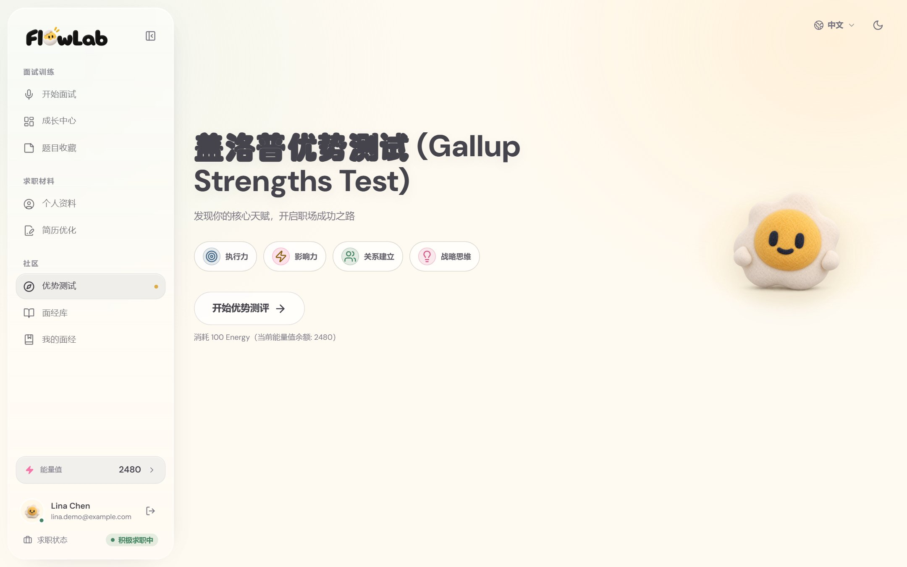</td>
<td width="50%">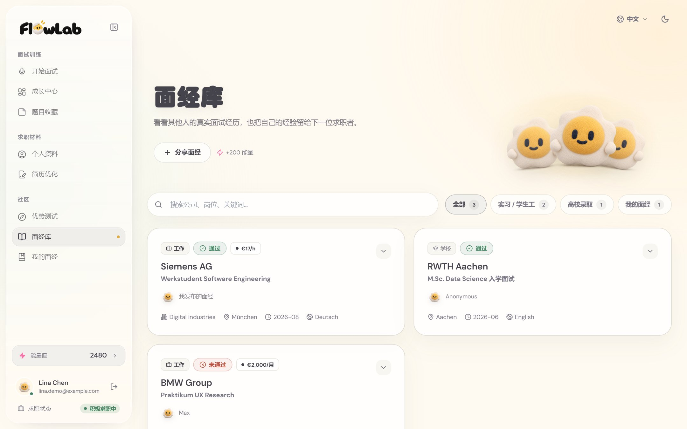</td>
</tr>
</table>

- **优势测试**：20 道题，看清你在执行力、影响力、关系建立、战略思维四大领域的长处——下次被问「你最大的优势是什么」，回答有理有据。
- **荷包蛋们的面经社区**：匿名分享遇到的问题、自己的回答和后来想明白的事。没有标准答案，只有更多可参考的真实经验。分享一篇还能获得能量奖励。

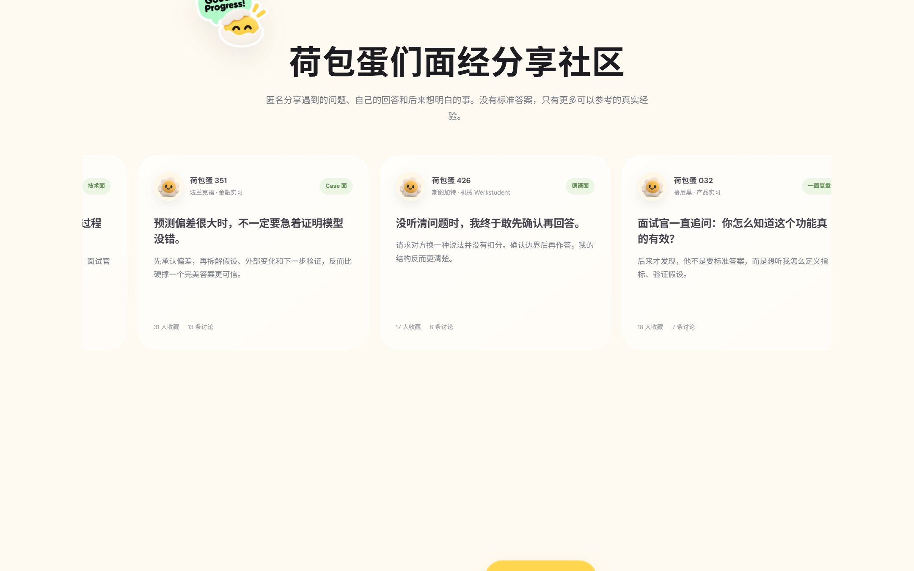

<br/>

## 🧠 背后的技术

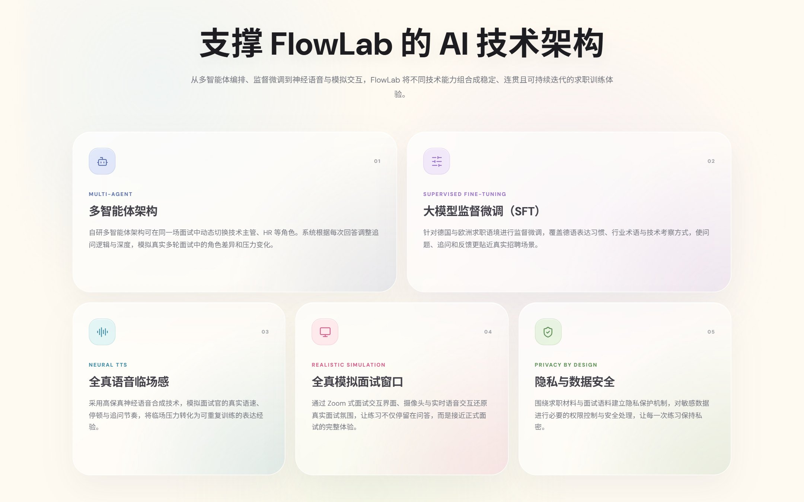

| | 能力 | 对你意味着什么 |
|:---:|---|---|
| 🤖 | **多智能体面试编排** | 同一场面试里，技术主管和 HR 等角色轮番提问，并根据你的每次回答调整追问方向和深度，还原真实多轮面试的节奏与压力 |
| 🗣️ | **Gemini Live 实时语音** | 低延迟的语音对话，面试官用自然的神经语音提问、停顿、追问——练的是开口，而不是打字 |
| 🎯 | **简历 × JD 双向理解** | 题目、追问和评分都基于你的经历和目标岗位生成，每一场都是只属于你的面试 |
| 🌍 | **德国与欧洲求职语境** | 中英德三语面试，贴近德企的表达习惯、行业术语和技术考察方式 |
| 🔁 | **可恢复、不重复扣费** | 面试进度保存在服务端，断线刷新都能接着来；网络重试不会重复出题或重复扣能量 |
| 🔒 | **隐私优先** | 简历和面试语料只用于你的练习，敏感数据有严格的权限控制，你可以随时删除自己的记录 |

<br/>

## 📱 手机上也能练

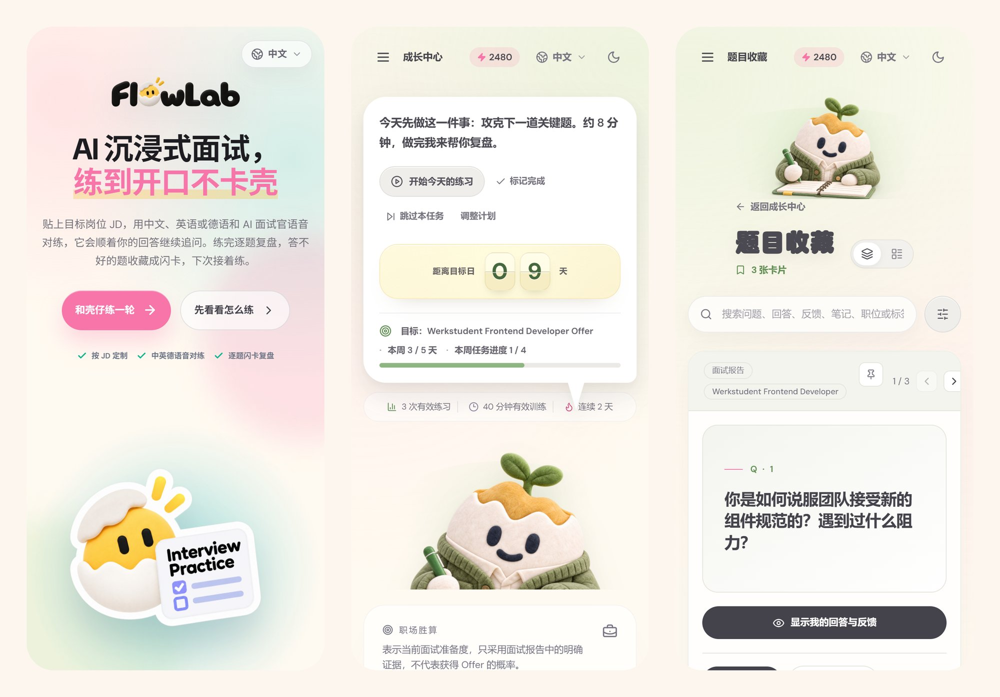

界面支持 **中文 / English / Deutsch** 三种语言，并且可以和面试语言分开设置；浅色、深色主题随你切换。

<br/>

## ⚡ 能量值

大部分 AI 功能会消耗能量值。**新用户赠送 1000 能量**，分享面经还能再领奖励。

| 用来做什么 | 能量 |
|---|:---:|
| 开始一场模拟面试 / 针对某道题再练一次 | 300 |
| 简历诊断 | 200 |
| 定向简历 / 求职信 | 各 100 |
| 优势测试 | 100 |
| 简历 PDF 解析 | 50 |
| 分享一篇面经 | **+200** |

<br/>

## 🔜 即将上线

- **岗位匹配**：岗位侦探根据你的简历推荐适合的岗位方向，并说明匹配依据和投递优先级。
- **数字人面试官**：在语音之外，看得见的面试官形象。

<br/>

## 🛠 开发者入口

<details>
<summary><b>这是一个前后端同仓库的项目，点开看看怎么在本地跑起来</b></summary>

<br/>

| 目录 | 内容 | 部署 |
|---|---|---|
| `frontend/` | React 18 + Vite 客户端 | Firebase Hosting（合并到 `main` 自动发布，PR 自动生成预览） |
| `backend/` | Node.js 22 + Express API、面试智能体、Gemini Live | Google Cloud Run |
| `docs/` | 产品说明、开发指南、技术架构、运维手册 | — |

数据与登录由 **Supabase** 提供（PostgreSQL + Google / LinkedIn 登录），AI 能力来自 **Google Gemini**。

需要 Node.js 22.12+。前后端各开一个终端：

```powershell
cd backend
npm ci
npm run dev
```

```powershell
cd frontend
npm ci
npm run dev
```

后端默认 `http://localhost:5000`，前端默认 `http://localhost:3000`。首次运行前从 `.env.example` 复制出 `.env` 并填好配置；
**不要** 把后端的 Service Role Key 写进任何 `VITE_*` 变量，也不要提交真实的 `.env`。

更多细节：

- 📖 [文档首页](docs/README.md) · [产品概览](docs/01-产品/产品概览.md)
- 🧑‍💻 [本地开发](docs/02-开发指南/本地开发.md) · [环境变量](docs/02-开发指南/环境变量.md) · [测试](docs/02-开发指南/测试.md)
- 🏗 [系统总览](docs/03-技术与架构/系统总览.md)
- 🚀 [部署总览](docs/05-运维/部署总览.md) · [故障排查](docs/05-运维/故障排查.md)

</details>

<br/>

---

<div align="center">

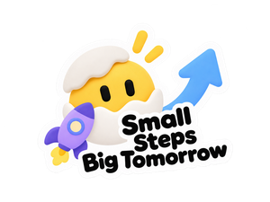

**FlowLab 不卡壳实验室** — 壳仔陪练 · 破壳同学成长

[🥚 免费开始第一轮](https://global.flowlab-career.com)

<sub>© 2026 不卡壳实验室 FlowLab · 首页展示的院校与企业标识仅为示例，不代表官方合作</sub>

</div>
