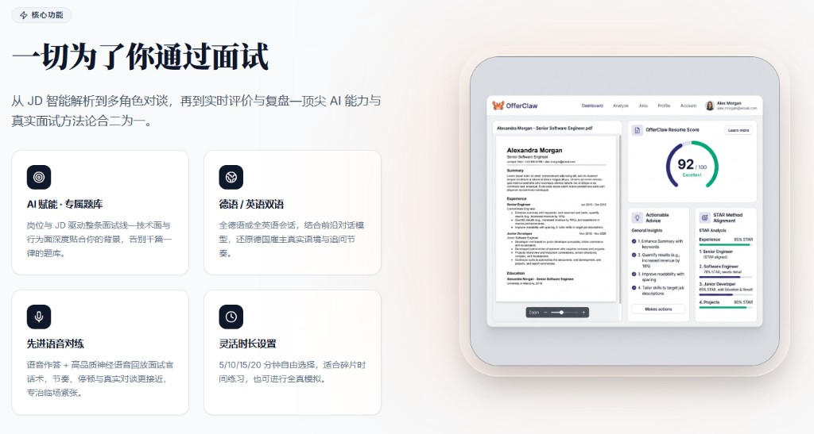
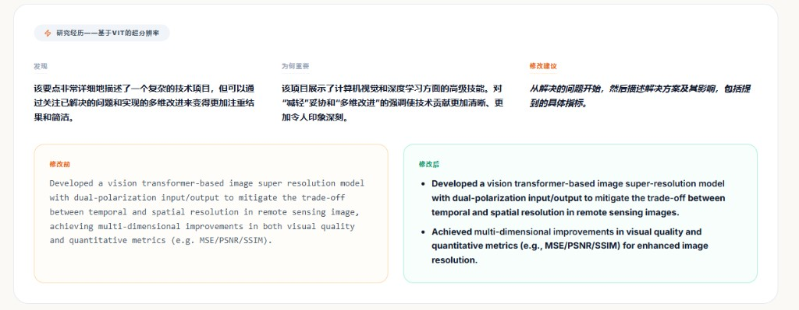
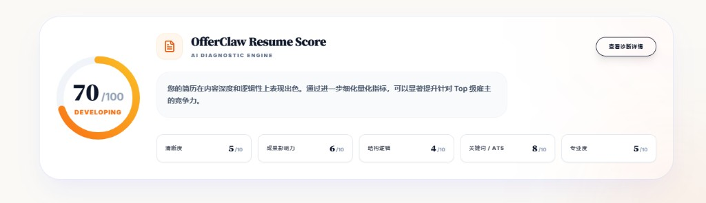
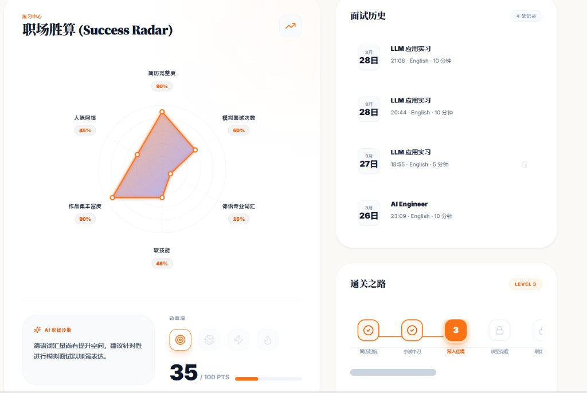
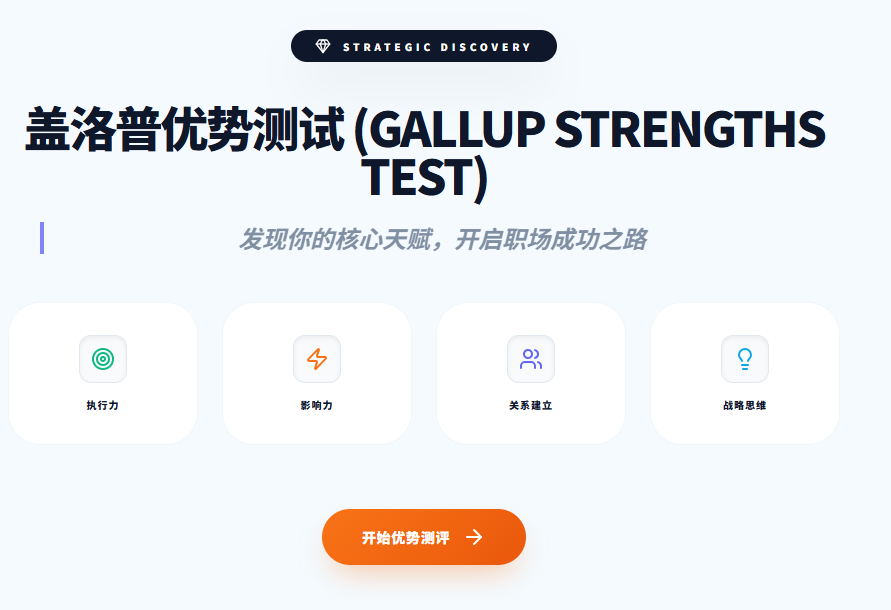
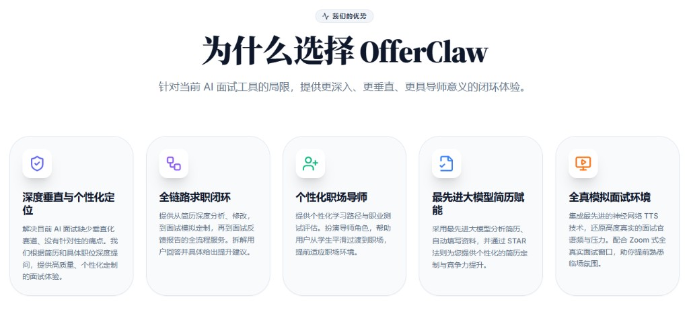

# 产品概览

> 状态：现行 · 最后核对：2026-10-01 · 对应技术文档：[系统总览](../03-技术与架构/系统总览.md)

## 定位

面向赴德实习、求职和升学人群的 AI 面试训练平台。它会读取用户的简历和目标岗位 JD，模拟真实面试官的提问和追问，再用结构化报告、题目复盘和成长计划，帮助用户在一次次练习中逐步提高。

一句话：**不是通用聊天机器人，而是理解你的简历、读懂你的 JD、按真实面试节奏追问的全链路训练系统。**

线上地址：[https://aiinterviewer-491711-7b1cf.web.app](https://aiinterviewer-491711-7b1cf.web.app)（Google 或 LinkedIn 账号登录）

## 名称约定

| 名称                       | 用在哪里                                                    | 说明                                                                  |
| -------------------------- | ----------------------------------------------------------- | --------------------------------------------------------------------- |
| **LandIt**           | 用户可见的产品名                                            | 网页标题、界面文案、品牌图标都用这个名字，文档中提到产品时统一使用    |
| OfferClaw                  | 旧的前端说明文档                                            | 历史宣传名，不再使用                                                  |
| InterviewDE                | 后端服务名、`package.json`、健康检查里的 `service` 字段 | 只作为代码内部名称，不面向用户                                        |
| `ai_interviewer_backend` | GitHub 仓库名、本地 Supabase`project_id`                  | 仓库标识，同时包含前后端                                              |
| 能量值（Tokens）           | 界面里的计费单位                                            | 代码和数据库中叫`tokens`，详见[账户与计费](../03-技术与架构/通用机制/账户与计费.md) |

## 目标用户与要解决的问题

- 申请德国 Werkstudent、Praktikum、全职岗位或学校面试的学生和职场新人；
- 刷了很多题，实际面试却被问 Behavioral 问题，不知道面试官真正想考什么；
- 自己练口语没人追问，不知道回答哪里有漏洞；
- 简历改了很多版仍然没有回音，不知道问题出在哪。

## 功能地图

登录后的侧栏分为三组，下表列出全部已上线的模块，同时作为功能清单。各模块的详细规则见对应的功能说明，跨模块的规则见[通用规则](通用规则.md)。

| 分组 | 模块 | 路由 | 用户能做什么 | 消耗能量值 | 说明 |
| --- | --- | --- | --- | --- | --- |
| 公开页面 | 首页、登录 | `/`、`/login` | 产品介绍、Google / LinkedIn 登录 | | [首页与登录](功能说明/首页与登录.md) |
| 面试训练 | 面试配置 | `/setup` | 粘贴 JD 自动识别岗位，选择面试类型、面试官性格、模式、难度、语言和时长 | 开始面试 300 | [面试配置](功能说明/面试配置.md) |
| 面试训练 | 模拟面试 | `/interview/:id` | 在面试房间里用语音或文字作答；练习模式可以暂停、看提示、重答、掌握、跳过；正式模式连续计时 | | [模拟面试](功能说明/模拟面试.md) |
| 面试训练 | 面试报告 | `/interview/:id/report` | 结构化反馈、五维准备度、逐题复习，自动翻译成界面语言 | 针对练习 300 | [面试报告](功能说明/面试报告.md) |
| 面试训练 | 成长中心 | `/dashboard` | Offer 冲刺计划、职场胜算、训练统计、最新复盘、面试复盘记录 | 针对练习 300 | [成长中心](功能说明/成长中心.md) |
| 面试训练 | 题目收藏 | `/notes` | 复习练习和报告中收藏的题目，再练一次 | 再练一次 300 | [题目收藏](功能说明/题目收藏.md) |
| 求职材料 | 简历优化 | `/resume-tailor` | 按 JD 优化简历（不虚构经历），生成求职信 | 各 100 | [简历优化](功能说明/简历优化.md) |
| 求职材料 | 个人资料 | `/profile` | 维护默认简历、PDF 解析、简历诊断与评分、头像、能量值 | 解析 50，诊断 200 | [个人资料与简历](功能说明/个人资料与简历.md) |
| 求职材料 | 优势测试 | `/gallup` | 20 题测评，得到四大领域的得分和解读 | 100 | [优势测试](功能说明/优势测试.md) |
| 社区 | 面经库 | `/experiences` | 浏览公开面经（无需登录），分享自己的面经 | 分享 +200 | [面经库](功能说明/面经库.md) |

尚未上线：数字人面试官、付费能力、邮件提醒。

## 核心能力

- **岗位与 JD 驱动**：题目和追问都基于用户的简历和目标 JD 生成，不是固定题库。
- **三种面试官类型**：HR 面不问深度技术题，技术面不会变成纯 HR 问答，综合面两者都覆盖。
- **练习与正式两种模式**：练习模式重在学习，可以随时暂停、看提示、反复作答；正式模式重在模拟，由服务端计时，最后统一出报告。
- **实时语音**：基于 Gemini Live 的语音对话，面试官用神经语音朗读问题。
- **多语言**：面试支持英语、德语和中文；界面支持中、英、德三种语言，两者可以分开设置。
- **可恢复**：刷新页面或断线后，回到 `/interview/:id` 就能继续这一场面试。

## 简历分析与评分

上传简历后，AI 会逐条检查每个 bullet point：指出模糊表述和缺少量化的地方，说明为什么要改，并给出修改前后的对比。

简历评分给出综合分，以及清晰度、成果影响力、结构逻辑、关键词 / ATS 覆盖、专业度几个维度的分数，并附一份按优先级排序的修改清单。

## 成长中心

打开页面先看到"今天该做什么"，再看结果和历史：

- **Offer 冲刺计划**：设定目标岗位和日期，查看倒计时、本周进度和今天的唯一任务；
- **职场胜算**：只依据面试报告中的证据，从技术、经历证据、结构表达、沟通协作、策略匹配五个维度评估；
- **最新复盘**：直达报告；暂停的练习可以从原来的进度继续；
- **面试复盘记录**：按"有报告"和"待继续"筛选。

## 盖洛普优势测试

测评覆盖四大领域：执行力、影响力、关系建立、战略思维。结果可以用来准备"你最大的优势是什么"这类经典问题。

## 能量值

大部分 AI 功能都会消耗能量值。新用户赠送 1000，分享面经可以获得奖励，目前没有充值渠道。具体规则见[通用规则 · 能量值](通用规则.md#2-能量值)。

## 竞争优势

| 能力       | 描述                                                       |
| ---------- | ---------------------------------------------------------- |
| 深度个性化 | 根据简历和 JD 提问，是属于你自己的面试                     |
| 全链路闭环 | 简历分析 → 修改建议 → 模拟面试 → 反馈报告 → 针对性再练 |
| 职场导师   | 优势测评与成长计划，帮助从学生过渡到职场                   |
| 简历赋能   | 按 STAR 法则拆解经历、量化成果                             |
| 全真模拟   | 神经语音还原面试压力，面试房间界面贴近线上面试             |
