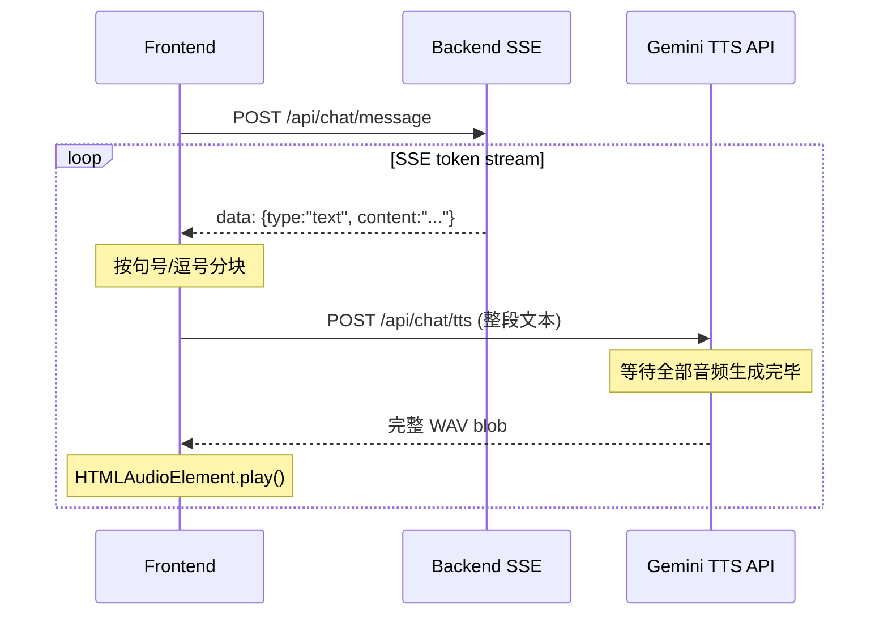
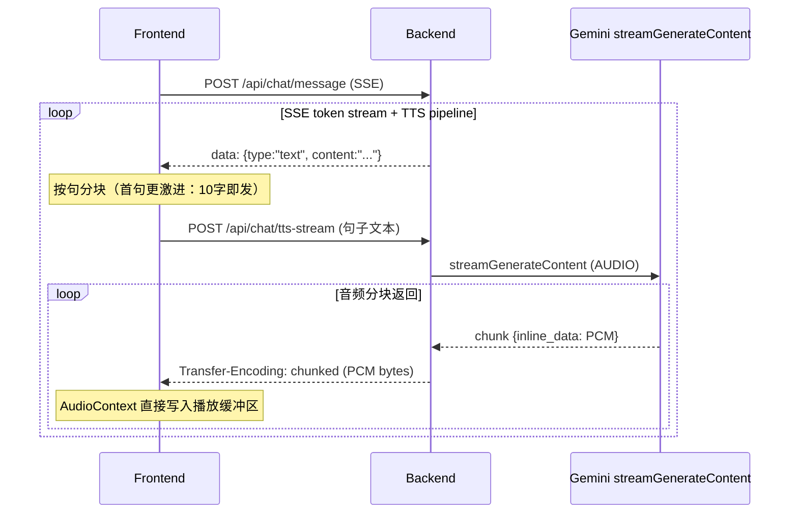

# 增量流式 TTS 改造方案

## 现状分析

当前链路（已有部分优化）：




**瓶颈所在**：

1. 后端 TTS 使用 `generateContent`（非流式），必须等 Gemini 生成完整音频才返回 -- 这是最大的延迟源
2. 前端使用 `HTMLAudioElement` + blob URL，需完整文件才能播放
3. 句间切换有明显间隙（revoke URL → 创建新 Audio → play）

## 改造后目标架构




## 改动范围

### 1. 后端：新增流式 TTS 端点

**文件**: `[backend/src/routes/chat.js](backend/src/routes/chat.js)`

- 新增 `POST /api/chat/tts-stream` 路由
- 使用 Gemini 的 `streamGenerateContent` 替代 `generateContent`
- 返回 `Transfer-Encoding: chunked`，Content-Type 为 `audio/pcm`（原始 PCM，不封装 WAV）
- 每收到一个 Gemini 流式 chunk 就解码 base64 PCM 并 `res.write()` 给前端
- 在响应头中携带 `X-Sample-Rate: 24000` 供前端解码
- 保留原 `/tts` 端点作为降级回退

核心代码思路：

```javascript
router.post('/tts-stream', requireAuth, async (req, res) => {
  const { text, language } = req.body
  // ...
  const url = `https://generativelanguage.googleapis.com/v1beta/models/${model}:streamGenerateContent?alt=sse&key=${apiKey}`
  
  res.setHeader('Content-Type', 'audio/pcm')
  res.setHeader('X-Sample-Rate', '24000')
  res.setHeader('Transfer-Encoding', 'chunked')
  
  const ttsRes = await fetch(url, { method: 'POST', body: JSON.stringify(body) })
  // 逐 chunk 读取 Gemini 流式响应，解码 base64 PCM，res.write() 给前端
  for await (const chunk of parseSSEStream(ttsRes.body)) {
    const pcmBytes = Buffer.from(chunk.inlineData.data, 'base64')
    res.write(pcmBytes)
  }
  res.end()
})
```

### 2. 前端：Web Audio API 流式播放器

**文件**: `[frontend/src/components/ChatInterface.jsx](frontend/src/components/ChatInterface.jsx)`

重写 `useGeminiTTS` hook 为 `useStreamingTTS`：

- 使用 `AudioContext` + 双缓冲区（double-buffering）播放 PCM 流
- 通过 `fetch` + `ReadableStream` 读取 `/api/chat/tts-stream` 的 chunked response
- 每收到一段 PCM bytes 就创建 `AudioBuffer` 并调度到 `AudioBufferSourceNode` 播放
- 维护一个时间轴指针 `nextStartTime`，实现句间无缝拼接（gapless playback）
- 支持多句并行请求：第 N 句的 TTS fetch 与第 N-1 句的播放同时进行

核心代码思路：

```javascript
function useStreamingTTS(language, enabled) {
  const ctxRef = useRef(null) // AudioContext
  const nextTimeRef = useRef(0) // 下一个 buffer 开始播放的时间点
  
  const enqueue = async (text, authToken) => {
    const ctx = ctxRef.current || (ctxRef.current = new AudioContext({ sampleRate: 24000 }))
    const res = await fetch(`${BACKEND_URL}/api/chat/tts-stream`, { ... })
    const reader = res.body.getReader()
    let pcmAccum = new Uint8Array(0)
    
    while (true) {
      const { done, value } = await reader.read()
      if (done) break
      // 合并 PCM bytes，达到一定长度就调度播放
      pcmAccum = concat(pcmAccum, value)
      if (pcmAccum.length >= MIN_CHUNK_BYTES) {
        scheduleBuffer(ctx, pcmAccum) // 创建 AudioBuffer → AudioBufferSourceNode.start(nextTime)
        pcmAccum = new Uint8Array(0)
      }
    }
    if (pcmAccum.length > 0) scheduleBuffer(ctx, pcmAccum)
  }
}
```

### 3. 优化分句策略

**文件**: `[frontend/src/components/ChatInterface.jsx](frontend/src/components/ChatInterface.jsx)` 第 606-636 行

- **首句更激进**：第一个 chunk 只需 8-10 个字符 + 任意标点即发送，确保 "first audio byte" 尽可能快
- **后续句子**：保持当前策略（逗号 45 字 / 句号 / 75 字强制切）
- **并发预取**：当第 N 句 TTS 正在生成时，如果第 N+1 句文本已就绪，立即发起 TTS 请求（当前已在做，保持不变）

### 4. 降级与容错

- 若 `streamGenerateContent` 失败，自动回退到原 `/api/chat/tts`（完整 WAV）
- 若 `AudioContext` 不可用（极少数浏览器），回退到 `HTMLAudioElement` + blob
- 保留原 `useGeminiTTS` 代码，通过 feature flag 或 try-catch 切换

## 预期效果


| 指标               | 改造前                   | 改造后                           |
| ---------------- | --------------------- | ----------------------------- |
| First Audio Byte | 1.5-3s（等整段 TTS 完成）    | 200-500ms（流式首 chunk）          |
| 句间间隙             | 200-500ms（Audio 对象切换） | ~0ms（gapless AudioContext 调度） |
| 感知延迟             | "等了好久才开口"             | "几乎立即开始说话"                    |


## 不改动的部分

- LangGraph 面试逻辑（`interviewGraph.js`）不变
- SSE 文本流（`POST /api/chat/message`）不变
- STT 语音识别不变
- 面试 UI 布局不变

